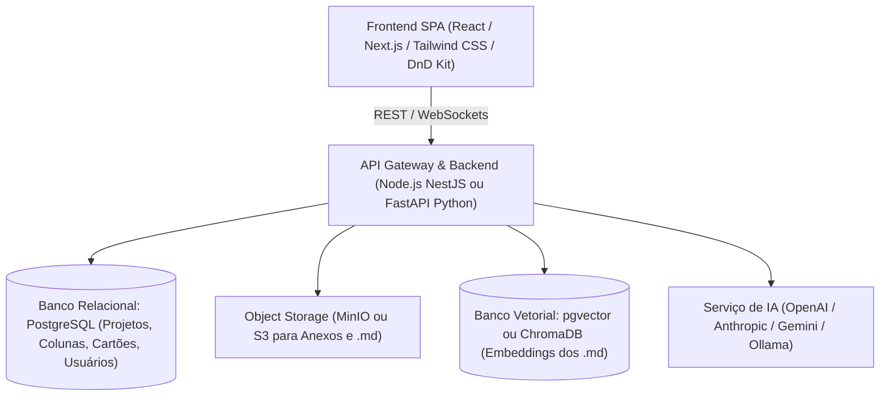

# Spec de Funcionalidades — Trello AI (Kanban Inteligente)

Sistema web de gerenciamento visual de projetos baseado na metodologia Kanban, inspirado na experiência e flexibilidade do Trello, integrado a um motor de Inteligência Artificial para automação de cadastros, monitoramento contínuo, análise contextual via documentação `.md` e dashboard analítico executivo.

---

## 1. Núcleo Kanban & Gestão Visual (Padrão Trello+)

### 1.1 Projetos e Quadros (Boards)
- **Criação e Gestão**: Múltiplos quadros por projeto com suporte a visibilidade pública, privada ou de equipe.
- **Customização Visual**: Capas personalizadas (gradientes, imagens, cores), ícones temáticos e descrição estruturada.
- **Estrutura de Colunas/Listas**:
  - Listas padrão dinâmicas (`Backlog`, `A Fazer`, `Em Progresso`, `Revisão/Bloqueado`, `Concluído`).
  - Arraste bidirecional de colunas (drag-and-drop).
  - Limite de Trabalho em Progresso (WIP Limits) por coluna com alerta visual de gargalo.

### 1.2 Cartões (Cards) & Tarefas
- **Propriedades Essenciais**:
  - Título, descrição rica em Markdown com suporte a checklists, código, tabelas e links.
  - Atribuição de responsáveis e observadores.
  - Etiquetas (Tags) coloridas e categorizadas (ex.: `Prioridade: Alta`, `Bug`, `Feature`, `Documentação`).
  - Datas de início, prazos de entrega (due dates) com notificações de vencimento e status (`No prazo`, `Atrasado`, `Entregue`).
  - Anexos (imagens, arquivos `.pdf`, `.zip`, diagramas).
  - Campos customizados: Estimativa de horas, esforço (Story Points), centro de custo, complexidade.
- **Interações**:
  - Drag-and-drop nativo entre listas e posições na mesma lista com persistência instantânea.
  - Checklists com barra de progresso individual por cartão.
  - Histórico de auditoria e linha do tempo de alterações por cartão.
  - Seção de comentários com menções (`@membro`) e formatação em tempo real.

---

## 2. Inteligência Artificial Integrada

### 2.1 Cadastro Assistido de Tarefas
- **Prompt-to-Card**: Criação de tarefas a partir de linguagem natural (ex.: *"Criar uma tarefa para implementar autenticação OAuth2 no backend até sexta, prioridade alta"*). A IA preenche título, descrição detalhada, checklists sugeridos, tags e prazo automaticamente.
- **Decomposição Automática de Projetos/Épicos**: Quebra de um objetivo complexo em múltiplos cartões encadeados com critérios de aceitação gerados por IA.
- **Preenchimento Inteligente**: Sugestão de tags, estimativa de horas e responsável com base no histórico do projeto.

### 2.2 Monitoramento Proativo & Análise de Gargalos
- **Detecção de Impedimentos**: Identificação de cartões parados por muito tempo em colunas sem movimentação ou com prazos estourados.
- **Resumos Periódicos (Digest)**: Geração de resumos executivos diários ou semanais do progresso de cada quadro.
- **Previsibilidade e Risco**: Cálculo de probabilidade de atraso em entregas críticas com base no ritmo do time.

### 2.3 Base de Conhecimento e RAG com Documentos `.md`
- **Upload e Indexação de Arquivos Markdown**:
  - Upload de arquivos `.md` contendo escopo do projeto, requisitos técnicos, regras de negócio, arquitetura ou atas de reunião.
  - Processamento, chunking e indexação em banco vetorial (Embeddings).
- **Assistente Contextual do Projeto (Chat Q&A)**:
  - Chat lateral integrado ao quadro.
  - O assistente responde dúvidas técnicas e de escopo consultando diretamente a documentação `.md` ingerida e os cartões ativos.
  - Exemplos de consultas:
    - *"Qual é a regra de negócio para expiração do token de autenticação segundo a doc?"*
    - *"Quais tarefas pendentes no backlog dependem do módulo de pagamentos?"*
  - O assistente auxilia na criação de tarefas já alinhadas com as especificações da documentação existente.

### 2.4 Extração & Preenchimento Automático de Tecnologias (Tech Stack Auto-Fill)
- **Leitura Semântica do Documento `.md`**:
  - Durante o upload ou sincronização de documentos (como `README.md`, `ARCHITECTURE.md` ou especificações técnicas), o motor de IA analisa o conteúdo em busca de referências técnicas, ferramentas e arquiteturas mencionadas.
- **Detecção Estruturada de Stack**:
  - **Linguagens**: Ex.: TypeScript, Python, Rust, Go, SQL.
  - **Frameworks & Libs**: Ex.: Next.js, React, FastAPI, Tailwind CSS, NestJS, Prisma.
  - **Bancos de Dados & Storage**: Ex.: PostgreSQL, MongoDB, Redis, S3, MinIO, pgvector.
  - **Infraestrutura, DevOps & Cloud**: Ex.: Docker, Kubernetes, AWS, Vercel, GitHub Actions.
  - **Protocolos & Arquitetura**: Ex.: REST, GraphQL, WebSockets, gRPC, Microserviços.
- **Auto-População do Projeto e do Quadro**:
  - Preenchimento automático do perfil técnico do projeto e badges do cabeçalho.
  - Criação automática de Etiquetas/Tags técnicas correspondentes no quadro (ex.: etiqueta `[React]`, `[PostgreSQL]`, `[FastAPI]`).
  - Geração de sugestões de categorização para cartões novos ou importados com base na tecnologia identificada.
- **Validação com o Usuário**:
  - Modal de confirmação inteligente exibindo a lista de tecnologias detectadas, permitindo aceitar com 1 clique, ajustar versões ou adicionar itens antes de persistir.

---

## 3. Dashboard Analítico & Métricas de Projeto

### 3.1 Painel Central de Indicadores (KPIs)
- **Progresso Global e por Projeto**: Percentual consolidado de conclusão (% concluído ponderado por número de itens ou por story points).
- **Métricas de Vazão (Throughput)**: Quantidade de tarefas concluídas por período (dia, semana, sprint).
- **Lead Time e Cycle Time**: Tempo médio decorrido desde a criação até a entrega, e tempo real de execução.
- **Status de Prazos**: Distribuição quantitativa de itens no prazo, próximos do vencimento e em atraso.

### 3.2 Visualizações Gráficas
- **Distribuição por Categoria e Tags**: Gráficos de rosca/pizza com volume de trabalho por frente (Frontend, Backend, DevOps, etc.).
- **Distribuição por Coluna/Status**: Gráficos de barras empilhadas para identificar acúmulo de trabalho e gargalos de fluxo.
- **Curva de Burndown / Burnup**: Acompanhamento visual da redução do escopo planejado contra o tempo.
- **Distribuição de Carga de Trabalho**: Horas ou volume de cartões alocados por membro.

### 3.3 Filtros Avançados
- **Filtro Multicritério**:
  - Por Projeto / Quadro
  - Por Responsável / Membro
  - Por Categoria / Etiqueta / Prioridade
  - Por Intervalo de Datas (Criação, Vencimento, Conclusão)
  - Por Status de Saúde (Crítico, Em Alerta, Estável)
- **Busca Textual Global**: Pesquisa indexada por palavras-chave em títulos, descrições e comentários.
- **Salvamento de Visões**: Capacidade de salvar configurações de filtros frequentes como visões customizadas.

---

## 4. Módulo de Documentação & Gestão de Conhecimento

### 4.1 Hub de Documentação Nativo
- **Editor Markdown Integrado**: Visualização e edição side-by-side com suporte a sintaxe completa, blocos de código e diagramas Mermaid.
- **Organização em Árvore**: Pastas, subpastas e documentos anexados diretamente à raiz do projeto.
- **Sincronização com o Repositório**: Possibilidade de importar e exportar arquivos `.md` diretamente da interface.

### 4.2 Interação Documento-Quadro
- **Vínculo Cartão ↔ Documentação**: Vinculação direta de um trecho ou documento `.md` a cartões específicos do Kanban.
- **Auto-Update de Documentação**: IA sugere atualizações no `.md` do projeto conforme tarefas de arquitetura ou escopo são finalizadas.

---

## 5. Arquitetura de Software Recomendada

### 5.1 Tecnologias Sugeridas
- **Frontend**: Next.js 14+ (App Router), React, TypeScript, Tailwind CSS, `@hello-pangea/dnd` ou `@dnd-kit`, Lucide Icons, Shadcn UI / Radix Primitives, Recharts para dashboards.
- **Backend**: FastAPI (Python) ou NestJS / Node.js com TypeScript.
- **Banco de Dados**: PostgreSQL com extensão `pgvector` para unificar dados relacionais e busca semântica em uma única base.
- **Camada de IA & RAG**: LangChain / LlamaIndex para chunking, recuperação vetorial e orquestração de prompts com modelos LLM.
- **Comunicação em Tempo Real**: WebSockets / Socket.io para atualizações colaborativas simultâneas no quadro.
