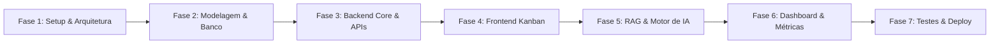

# Roadmap & Etapas de Desenvolvimento — Trello AI

Guia prático e faseado para a implementação da aplicação web Kanban com IA, ingestão de `.md` e Dashboard analítico.

---

## Visão Geral das Fases

---

## Fase 1: Setup de Ambiente, Arquitetura & Ferramental
- [x] **1.1 Definição de Arquitetura Clean Fullstack**:
  - `src/core/domain`: Entidades e Contratos de Repositório desacoplados de framework.
  - `src/core/use-cases`: Casos de uso de negócio puros (CRUD, cálculos de métricas, RAG, extração de stack).
  - `src/infrastructure`: Repositórios (`json-store.ts`), adaptadores NLP/IA (`rule-based-nlp.adapter.ts` e `ollama-ai.adapter.ts`) e Container DI.
  - `src/app` e `src/components`: Camada de apresentação reativa (Next.js 14 App Router, Tailwind CSS, Lucide, @dnd-kit).
- [x] **1.2 Configuração de Ferramentas de Qualidade**:
  - TypeScript Strict Mode (`tsc --noEmit` limpo), Tailwind CSS com paleta estendida `sage` e `forest`.
- [x] **1.3 Orquestração e Operação Zero-Dependência Externa**:
  - Execução offline imediata com armazenamento JSON atômico e NLP nativo, com suporte opcional a Ollama.

---

## Fase 2: Modelagem de Dados & Persistência

### 2.1 Entidades Relacionais
- [x] **Projetos/Boards**: `id`, `name`, `description`, `colorTheme`, `techStack`, `createdAt`, `updatedAt`.
- [x] **Colunas/Listas**: `id`, `boardId`, `title`, `order`, `wipLimit`.
- [x] **Cartões**: `id`, `columnId`, `title`, `description`, `order`, `dueDate`, `priority`, `status`, `completedAt`, `storyPoints`, `estimatedHours`, `checklists`, `tags`.
- [x] **Etiquetas/Categorias**: Categorização técnica e de escopo.
- [x] **Checklists**: Lista de subtarefas com controle de conclusão.

### 2.2 Entidades de IA e Conhecimento (.md)
- [x] **Documentos do Projeto**: `id`, `boardId`, `title`, `fileName`, `content`, `extractedTechs`, `createdAt`.
- [x] **RAG Chunking & Busca Semântica**: Indexação em seções e recuperação contextual por relevância.

---

## Fase 3: Backend Core & APIs em Tempo Real

- [x] **3.1 Endpoints de Estrutura Kanban**:
  - `GET /api/board`: Carrega o agregado do quadro completo.
  - `POST /api/cards`: Criação de tarefas.
  - `PUT /api/cards`: Movimentação e reordenação de cartões com recálculo automático de `status` e persistência garantida em disco.
  - `PATCH /api/cards/[id]`: Atualização detalhada.
  - `DELETE /api/cards/[id]`: Remoção atômica.
- [x] **3.2 Módulo de Documentação `.md` & Extração**:
  - `GET /api/docs` e `POST /api/docs`: Upload, visualização e extração automática de tecnologias da stack.
- [x] **3.3 APIs de IA & Analytics**:
  - `POST /api/ai/prompt-to-card`: Estruturação automática de tarefas via linguagem natural.
  - `POST /api/ai/doc-assistant`: Assistente RAG para esclarecimento de dúvidas sobre a especificação do projeto.
  - `GET /api/metrics`: Agregação em tempo real de KPIs executivos e detecção de gargalos.

---

## Fase 4: Frontend Kanban Interativo & Design Humano

- [x] **4.1 Sistema de Design Orgânico & Sem "Cara de IA"**:
  - Paleta dominante em tons de verde suave (Sage/Forest/Emerald), sidebar em verde suave (`#eef6f2` / `#0c221a`), tipografia editorial refinada.
  - Suporte completo a Modo Claro e Modo Escuro com transição suave.
- [x] **4.2 Tabuleiro Kanban com Drag-and-Drop Persistente**:
  - Implementação com `@dnd-kit/core` e `@dnd-kit/sortable`.
  - Captura de coluna de origem (`sourceColumnIdRef`), persistência garantida no backend e atualização imediata do status (`BACKLOG`, `TODO`, `IN_PROGRESS`, `IN_REVIEW`, `DONE`).
  - Animação suave de pulso na transferência e efeito comemorativo orgânico ao mover para Concluído.
- [x] **4.3 Modal de Detalhes do Cartão**:
  - Editor e visualizador Markdown, checklist interativo, prazos, horas estimadas e Story Points.
- [x] **4.4 Central de Documentação `.md`**:
  - Visualizador integrado com assistente de IA lateral para consulta instantânea.

---

## Fase 5: Pipeline RAG & Motor de Inteligência Artificial

- [x] **5.1 Extração Semântica Automática da Stack Tecnológica**:
  - Leitura de arquivos `.md` e identificação automática de tecnologias (TypeScript, Next.js, Docker, PostgreSQL, etc.) persistidas no quadro.
- [x] **5.2 Assistente RAG Contextual**:
  - Q&A em linguagem natural referenciando trechos dos documentos carregados.
- [x] **5.3 Funcionalidade Prompt-to-Card**:
  - Transformação de prompt livre em tarefa completa com títulos, critérios de aceitação e estimativas.
- [x] **5.4 Agente de Diagnóstico de Gargalos**:
  - Identificação de tarefas atrasadas, colunas acima do limite WIP e tarefas estagnadas com sugestões práticas.

---

## Fase 6: Dashboard Analítico & Filtros Avançados

- [x] **6.1 Agregação de Métricas Executivas**:
  - Taxa global de conclusão em percentual, Story Points entregues, horas estimadas e prazos.
- [x] **6.2 Gráficos Visuais com Recharts**:
  - Gráfico de rosca por categorias/tags com paleta esmeralda/verde menta/teal.
  - Gráfico de barras de ocupação por colunas e limites WIP.
- [x] **6.3 Filtros Dinâmicos**:
  - Filtro em tempo real por tags/categorias e prioridade (Urgente, Alta, Média, Baixa) no Dashboard e busca textual no Kanban.
